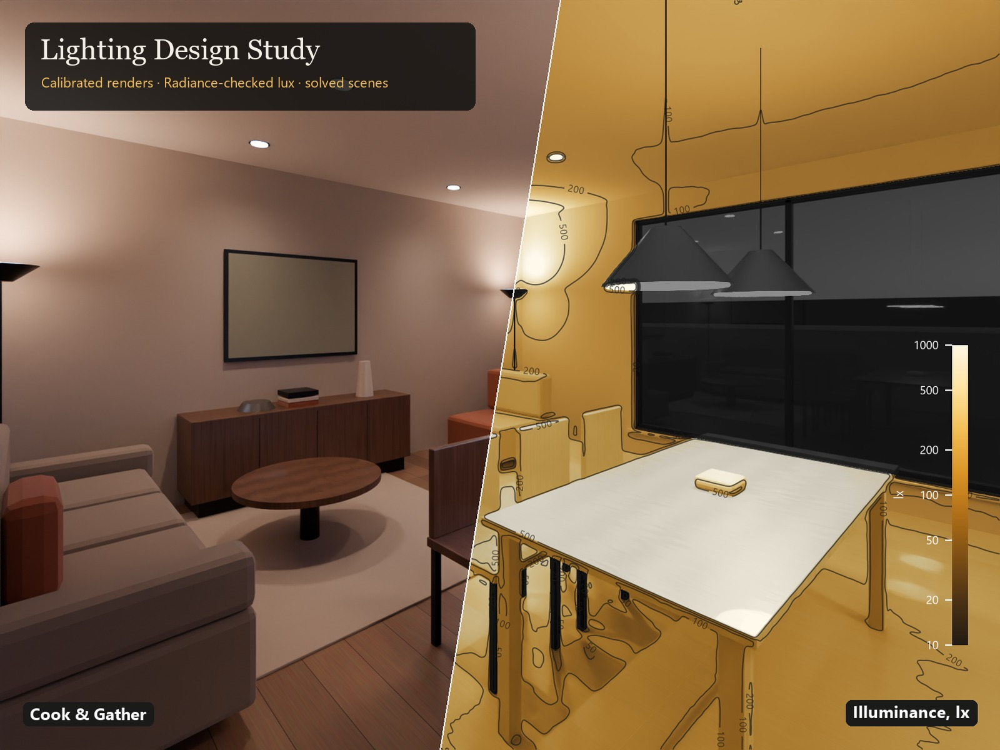

# Lighting Design Study

**Interactive report:** https://abdullah13793-commits.github.io/lighting-design-study/ (drag the slider)



A residential lighting study where the **photoreal renders, the lux plans and the numbers all come from the same
photometric (IES) files**, and the calculation is checked against LBNL Radiance. This is a demonstration project, not client work.

| | |
|---|---|
| Room | Open-plan living/kitchen, 7.2 × 5.0 × 2.7 m, 13 luminaires on 5 circuits |
| Scenes | Cook & Gather (all on) · Dinner (solved) · Sensory Calm (solved) · Daytime |
| Check vs Radiance 6.0 | full scene **+1.4 %** mean bias (direct light 0.4 %), calm scene +4.7 % |
| Tests | 14 closed-form / conservation tests (`pytest`) |
| Daylight | CIE overcast sky, mean daylight factor 6.7 % |

## What is in here

```
index.html            the interactive report (single file, everything embedded) served by GitHub Pages
src/lumen/            the engine: IES (LM-63) reader/writer, direct + radiosity illuminance, Radiance bridge
src/run_study.py      runs the study: scenes, zone metrics, solved dimming, Radiance validation, daylight factor
src/blender/          Blender 5.2 scene builder + photometric calibration of Cycles lights
src/render_maps.py    luminance (cd/m²) and illuminance (lx) maps from the calibrated EXR passes
src/make_*.py         figures, PDF report, viewer, slider video, LinkedIn carousel, publish images
config/               room, luminaires, scenes, zones (study.json) and cameras
data/ies/             generic LM-63 photometry files
tests/                engine tests
results/              results.json, grids, calibration and cross-check results
renders/final/        final Cycles renders (PNG; the linear EXRs are not in the repo, see below)
reports/              7-page PDF report and all figures
docs/                 METHOD.md (equations and assumptions), CASE_STUDY.md
```

## How it works

1. **Photometry.** Every luminaire is an LM-63 file. The reader handles all symmetry types, so manufacturer files drop straight in.
2. **Calculation.** Point-by-point direct illuminance (inverse-square and cosine law). Interreflections come from a
   radiosity solution on 2,238 patches with exact differential-area-to-polygon form factors, solved for all bounces.
3. **Scenes are solved.** Light is linear in each circuit's dimming level, so a bounded least-squares fit finds the levels
   that hit each zone's lux target at the lowest power.
4. **Independent check.** The same room and IES files run through Radiance (`ies2rad` + `rtrace`).
5. **Calibrated renders.** Cycles lights use the same IES files. A calibration render measured the watts-per-candela factor
   (0.2603 W gives I/683 W·sr⁻¹, shape error < 0.15 %), so the linear render passes are physical:
   L = 683·Y(Combined) cd/m², E = 683·π·Y(Diffuse Direct + Indirect) lx.

Full method: [docs/METHOD.md](docs/METHOD.md).

## Run it

```bash
pip install -r requirements.txt               # Python 3.13: numpy, scipy, matplotlib, pillow, OpenEXR, pytest
python -m pytest -q tests                      # engine tests
python src/run_study.py --skip-radiance        # calculation only (~1.5 min)
python src/run_study.py                        # + Radiance validation and daylight (needs Radiance 6, ~20 min)
python src/make_figures.py
```
Renders (optional, CPU ~15 min per frame): Blender 5.2, `powershell -File src/render_all.ps1`, then
`python src/render_maps.py renders/final B_full B_dinner B_calm B_day`.
The EXR files (≈100 MB each) are left out of the repository; re-render them to rebuild the light maps.

Edit `config/study.json` to use your own room, luminaires and targets.

## Limits

Furniture is not included in the calculation (it is in the renders). There are no glare (UGR/DGP) or melanopic metrics yet. The
photometry is generic, and the residential targets are design assumptions, not a cited standard. It is not a compliance
certificate, so have a qualified lighting professional review any real project.

## Author

Abdallah Alhussein · MSc Eng, Architectural Engineering, DTU (2026). Licence: MIT (code). Renders and report © the author.
